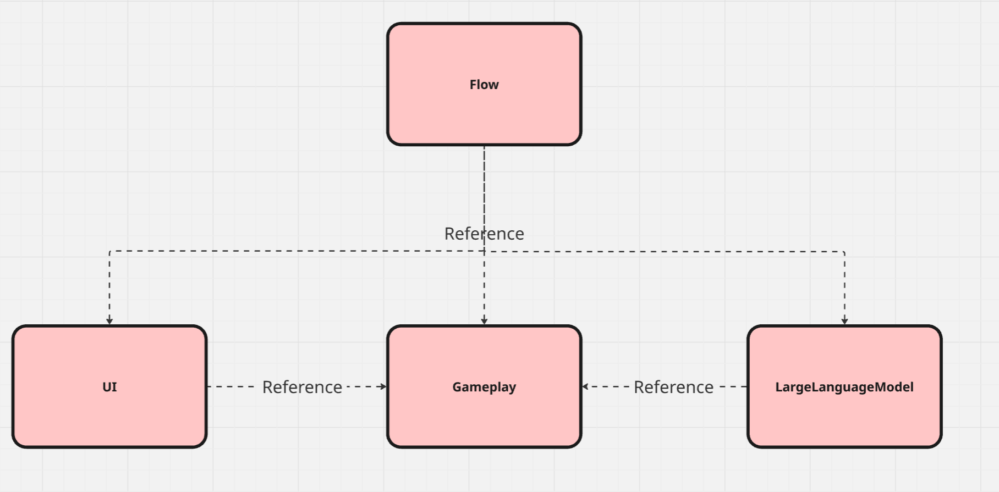
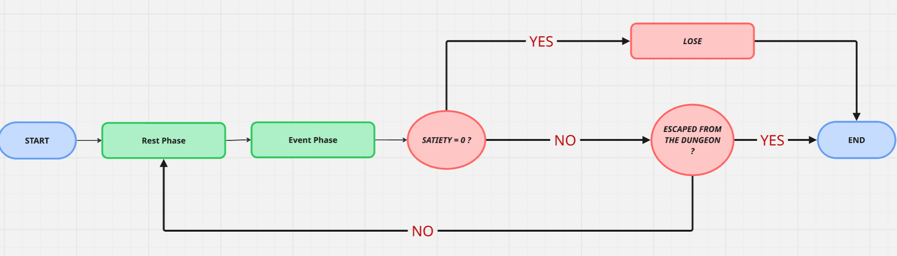
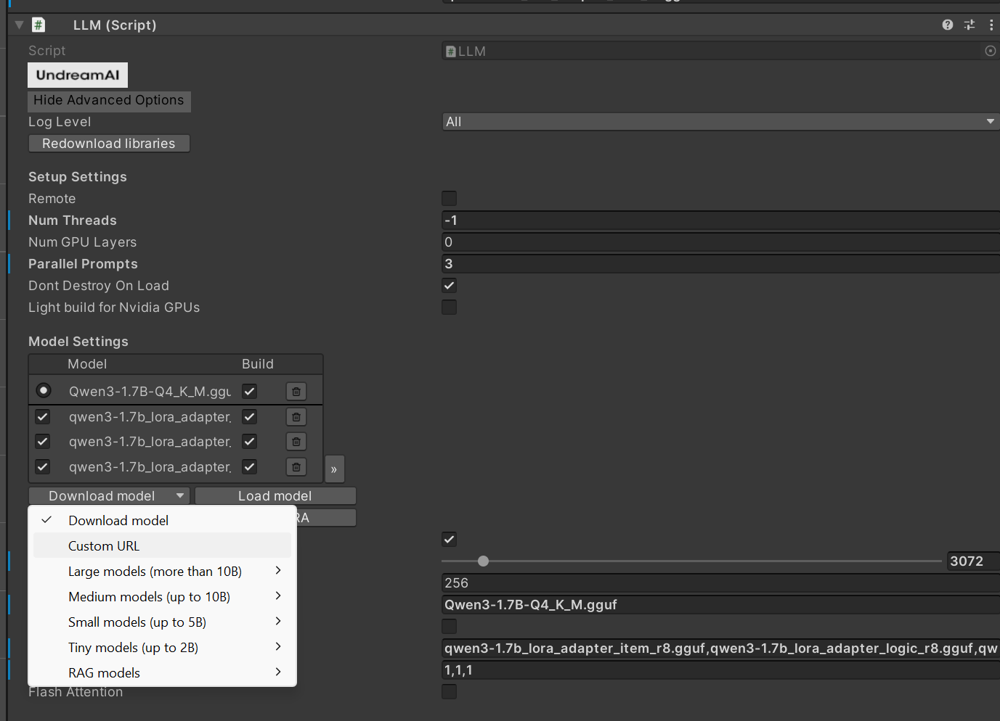

# Infinite Dungeon

> A proof-of-concept mobile game exploring **local LLM inference on Android**. Powered by `llama.cpp` and Unity, this project implements a fully offline, multi-agent narrative system to drive gameplay mechanics (survival, resource management, and event resolution) directly on-device.  
> *Developed as a Master’s thesis project, focusing on the technical compromise between player agency and mobile hardware constraints through a functional on-device implementation.*

---

## 📑 Table of Contents
1. [Overview](#-overview)
2. [Architecture & Technical Stack](#️-architecture--technical-stack)
   - [Game Architecture & Assembly Structure](#-game-architecture--assembly-structure)
3. [Core Optimizations for LLM Agency & Latency](#-core-optimizations-for-llm-agency--latency-1)
   - [Game Architecture & Lifecycle](#game-architecture--lifecycle)
   - [Multi-Agent System & Prompt Orchestration](#-multi-agent-system--prompt-orchestration)
   - [GBNF Grammars](#gbnf-grammars)
   - [Low-Rank Adaptation (LoRAs)](#low-rank-adaptation-loras)
4. [Getting Started](#-getting-started)
5. [Performance & Benchmarks](#-performance--benchmarks-mobile-target)
6. [About the Project & Limitations](#-about-the-project--limitations)
7. [License](#-license)

---

## 🎯 Overview

***Infinite Dungeon*** is a survival RPG where an escaped prisoner tries to escape from a dungeon. Unlike traditional text games relying on predefined branching paths or cloud-based APIs (OpenAI/Anthropic), this project runs entirely **on-device** without an internet connection, ensuring complete data privacy and zero API costs.

The core technical challenge addressed in this thesis prototype is balancing **player agency** (meaningful choices affecting gameplay stats) with the **hardware constraints** of mobile chips such as limited RAM, and CPU inference speeds.

---

## ⚙️ Architecture & Technical Stack

Here is a summary of the principal technical decisions chosen for the project:

- **Engine:** Unity 2022.3 (IL2CPP / Android)
- **Inference Runtime:** `llama.cpp` via the **LLMUnity** (UndreamAI) wrapper.
- **Base Model:** Qwen 3 (1.7B) in GGUF format (`Q4_K_M` quantization).
- **Fine-Tuning:** Custom LoRA (Low-Rank Adaptation) adapters (`r=8`) trained via **Unsloth** & **TRL** to specialize small models into distinct vertical roles.
- **Structured Outputs:** Application of **GBNF grammars** to strictly constrain LLM outputs into valid JSON, guaranteeing 100% parsing reliability.


### 🧱 Game Architecture & Assembly Structure

The codebase is strictly modularized into **4 distinct Assembly Definitions (`.asmdef`)** to enforce separation of concerns between game logic, UI, and AI handling:

<p align="center">
  
  <br><em>Modular assembly breakdown and dependency flow.</em>
</p>

1. **`LingeringHopes.UI`:** Manages all user interfaces, chat history display, dynamic action buttons pooling, and fade transitions.
2. **`LingeringHopes.Gameplay`:** Handles core game datas, managers (inventory, save), and player stats (satiety, exit progression).
3. **`LingeringHopes.Flow`:** Manages high-level game states, scene transitions, and orchestrates interactions between gameplay systems and external managers.
4. **`LingeringHopes.LargeLanguageModel`:** The dedicated AI bridge. It handles agent registration, prompt construction, history condensation, and benchmark tracking.

---

## ⚡ Core Optimizations for LLM Agency & Latency 

Achieving fluid on-device AI performance relies on several core architectural elements, especially those :   


### Game Architecture & Lifecycle

<p align="center">
  
  <br><em>Macroscopic game loop alternating between the Rest Phase and the Event Phase.</em>
</p>

The game loop alternates between a deterministic **Rest Phase** (managed purely by Unity code: eating, resting, advancing time) and an **Event Phase** (managed by the LLM).    
To mask background inference latency, the first narration of an upcoming event is pre-generated and cached during the preceding Rest Phase, ensuring a fluid user experience.


### 🤖 Multi-Agent System & Prompt Orchestration

To maintain a responsive framerate and avoid context thrashing, the game decouples tasks across **3 dedicated asynchronous agents** running on a 3-slot parallel context :

1. **Narration Agent (Slot 0):** Handles descriptive prose, atmospheric immersion, and player cues using a dedicated LoRA.
2. **Logic / Game Engine Agent (Slot 1):** Evaluates the game state, calculates consequences (satiety, progression), and outputs structured JSON strictly enforced by GBNF grammars.
3. **Item Agent (Slot 2):** Generates dynamic item descriptions and metadata at runtime when an item is obtained.


### GBNF Grammars

To eliminate the inherent unreliability of small-scale 1B/1.7B models when outputting raw JSON, custom flat **GBNF (GGML BNF)** grammars are injected at sampling time. This forces the model's logits mask to strictly respect schema structures (action strings, exact consequences like `DECREASED`/`INCREASED`), achieving 100% data parsing reliability and eliminating crashes.

Example of a GBNF rule used for the Logic Agent :
```gbnf
json ::= "{\"action\": \"" [a-zA-Z ]+ "\", \"satiety\": \""  ("DECREASED" | "NO CHANGE" | "INCREASED") "\", \"progression\": \""  ("DECREASED" | "NO CHANGE" | "INCREASED") "\", \"ended\": \"" ("YES" | "NO") "\", \"itemCollected\": \"" itemName "\"}"
itemName ::= ( [a-zA-Z ]+ | "None")
```

> *Note: GBNF grammars can be directly inspected on the respective agent components in the main scene.*

### Low-Rank Adaptation (LoRAs)

To prevent a single model from suffering under conflicting instructions (e.g., trying to write creative prose while simultaneously parsing strict JSON rules), fine-tuned LoRA adapters ($r=8$) are dynamically swapped. This modular approach provides expert-level outputs for each specific sub-task without the memory overhead of loading multiple full models.

(Jupyter notebooks and training datasets used for fine-tuning can be provided upon request).

---

## 🚀 Getting Started

### Prerequisites
- Unity 2022.3.x LTS
- Android SDK / NDK (if targeting mobile builds)

### Installation & Setup
1. Clone this repository:
   ```bash
   git clone https://github.com/LegerTistan/infinite-dungeon.git
   ```
2. Open the project in Unity 2022.3
3. Open the main scene in *Assets/Scenes/EventScene_Buttons.unity*. Here is a short explanation of the most important managers

- **LLMManager**: Central orchestrator managing the model connection and agent states.
- **EventMode & RestMode**: Core game loop state machines.
- **LiveBenchmarker**: Automated test suite tracking TTFT, TPS, and output quality.

> **Important Note on Models:** Due to file size limitations on GitHub, the base model (Qwen3-1.7B-Q4_K_M.gguf) is not bundled in the repository.  
> Upon first launch, LLMUnity will automatically download the required GGUF model via the internal DownloadManager into Application.persistentDataPath.   
> Alternatively, you can configure a custom URL through the expanded view (>>) of the model manager in the LLM component.

 

> The model used for my test is Qwen 3 1.7B Q4_K_M in GGUF format, available at this link : <https://huggingface.co/unsloth/Qwen3-1.7B-GGUF/resolve/main/Qwen3-1.7B-Q4_K_M.gguf>

## 📊 Performance & Benchmarks (Mobile Target)

Tested on mid-range Android hardware (Samsung Galaxy A33, Exynos 1280):

| KPI Name | Description | Metrics | Measured Value |
| :--- | :--- | :--- | :--- |
| **Latency** | The time elapsed between sending the request and displaying the first token. | TTFT, TPS, Duration | `~15s on average` |
| **Reliability** | The AI's ability to send a response respecting standards and guidelines defined beforehand. | Respected JSON format, correct expected JSON keyword | `~100% / responses` |
| **Creativity** | The AI's ability to renew its words, intent, and tone between each event. | Language diversity, presence of factual elements | `~50% / responses` |
| **Coherence** | The AI's ability to propose a narrative and consequences maintaining continuity with past events. | Consequence consistent with the scenario, correct event ending detection | `~75% / responses` |
| **Factuality** | The AI's ability to evoke tangible elements present in the environment and occurring during the event. | Stating physical elements, description of concrete visuals/sounds | `~65% / responses` |


## 📝 About the Project & Limitations

This project was developed over approximately 4 months, primarily as a solo developer during spare time. This is not a complete commercial game, but a proof of concept showcasing the current potential of on-device AI in the mobile gaming industry. The game is completely free to try.

The project has been made open-source to allow everyone to discover how local LLM inference works on mobile devices. It is also an opportunity to share knowledge on a complex and passionate subject. Furthermore, the techniques presented here are foundational concepts that can be freely explored and reproduced, so there is nothing really secret.

### Known Limitations

Current Large Language Models (LLMs) are not yet reliable enough to power a complete mobile game without occasional inconsistencies. You may encounter some issues when testing such as :

- **Inconsistent narration**: Some parts of the story may feel strange, incoherent, or unexpected.
- **Unexpected actions**: The AI may sometimes suggest actions in ways that don't logically match the current situation.
- **Food-only items**: For now, every item is considered edible, even keys! Other item types have not been implemented yet.
- **Occasional crashes**: In very specific situations, the game may unexpectedly crash.

Think of Infinite Dungeon as an exploratory project about on-device LLM for mobile games rather than a finalized game project.
Aside from that, if you are curious about how the AI performs, you can inspect the technical benchmark report (Benchmark.csv) generated locally in your device's persistent data path during testing.

## 📄 License

Distributed under the MIT License. See LICENSE for more information.
> If you use this project, fork it, or build upon it for your own research or portfolio, I would greatly appreciate a small credit or a shoutout pointing back to this repository !
